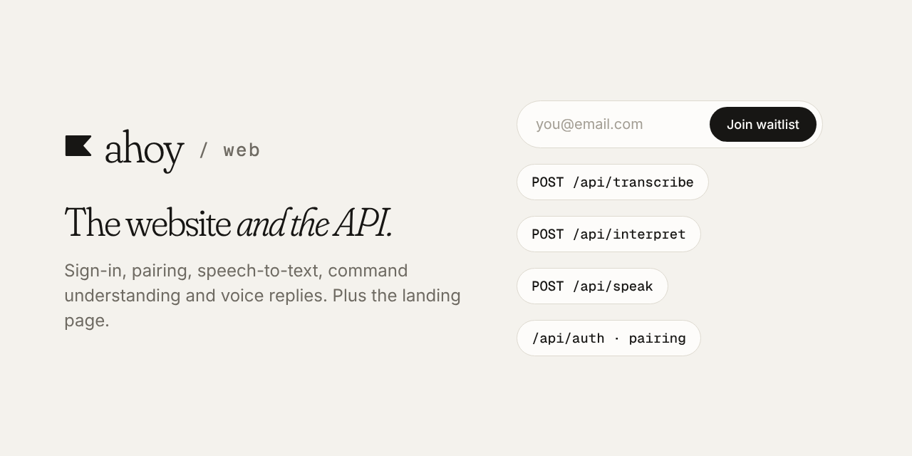

**Ahoy** is a voice assistant that lets you control your Mac from your phone. This repo is the website and the API behind it.

[▶ Watch the 1:45 demo](https://drive.google.com/file/d/1JMgSd2bm7LtUCs2WxiTNWuo0-bijqs4p/view?usp=sharing) · [All Ahoy repos](https://github.com/getahoy)

# Ahoy web

Next.js site and API for Ahoy: accounts (Better Auth) on Postgres (Neon, Drizzle).

## What's inside

| Route | Does |
|---|---|
| `/` | The landing page, with the early-access form and a "Try it yourself" voice demo |
| `/api/auth/*` | Accounts and device sign-in for the phone and the Mac (Better Auth) |
| `/api/transcribe` | Turns your recorded voice into text (ElevenLabs Scribe) |
| `/api/interpret` | Works out what you meant from your words and what's on screen (Claude) |
| `/api/speak` | Short spoken replies (ElevenLabs) |
| `/api/waitlist` | Early-access signups |

## Setup

```bash
pnpm install
cp .env.example .env.local
pnpm db:migrate
pnpm dev
```

`@getahoy/lib` comes from `../shared/packages/lib`; run `pnpm build` there first.

## Scripts

| Script | Does |
|---|---|
| `pnpm dev` | Dev server on port 3000 |
| `pnpm build` | Production build |
| `pnpm lint` | Biome checks |
| `pnpm typecheck` | Route types plus `tsc` |
| `pnpm db:generate` | Migration from schema changes |
| `pnpm db:migrate` | Apply migrations |
